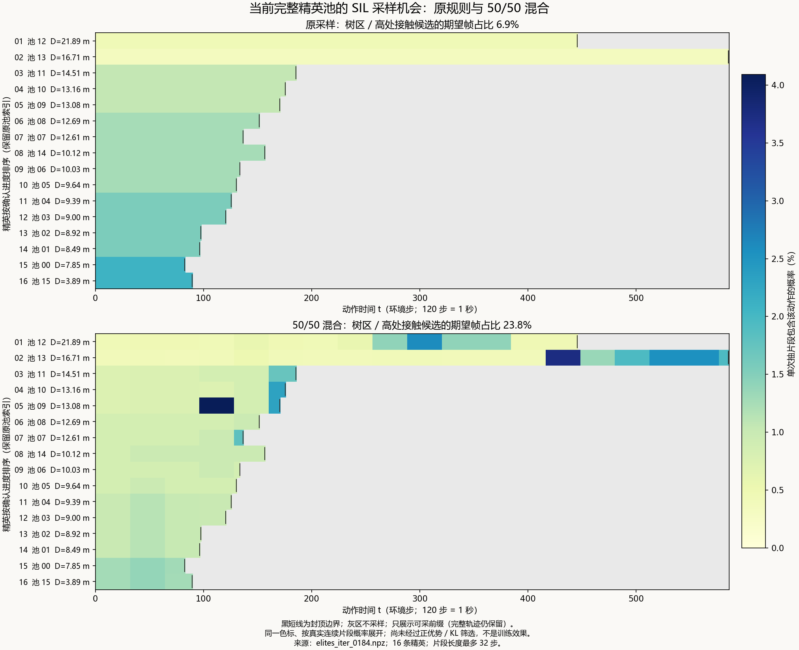
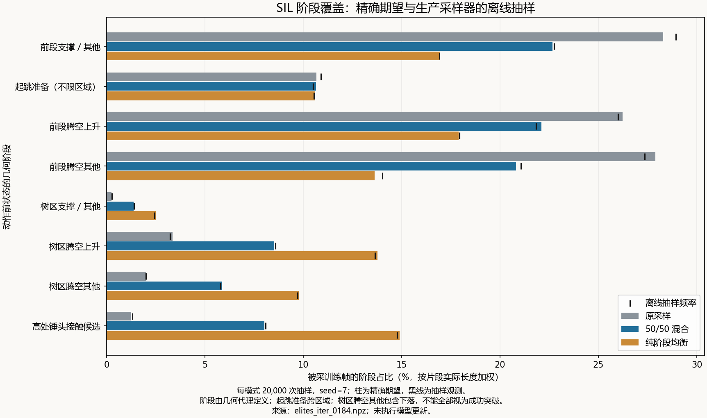

# GRU SIL 混合采样及精英池覆盖

2026-10-04。已实现 `phase_mixture_v1`，没有启动游戏或正式训练。采样对象为 checkpoint 184 对应的 16 条完整精英轨迹。

## 修改内容

每次抽片段以 50% 概率走“轨迹均匀 → 片段均匀”，以 50% 概率走“阶段均匀 → 该阶段片段均匀”。每轮不强制各占一半。新建 PPO 在开启 GRU SIL 时采用此规则；旧 checkpoint 恢复时保留其记录的规则，缺字段时为原采样。显式切换参数为 `--gru-sil-sampling-mode phase_mixture_v1`。

SIL 更新预算没有增加。仍以完整轨迹保存精英，仅抽确认进度封顶之前的连续片段；用当前权重重建完整前缀，保持完整尾部收益、正优势筛选、固定动作标准差和 KL 回滚。采样记录新增分支标识，并保留每阶段正优势帧数及优势权重，便于之后核对实际接受的更新。

## 采样图与结果

空间轨迹上的同一组标识已补充：[16 条精英总览](trajectories/all_elite_sampling.png)、
[最远精英的新旧规则并排图](trajectories/elite_12_sampling.png)。颜色越深越易采，星号为
封顶点，灰虚线是其后不进入片段训练的尾段；每条精英的单图索引见
[sampling_trajectories.json](trajectories/sampling_trajectories.json)。标注的是动作 t 对应的
锅心状态 t→t+1 线段，采样概率来自本目录同一个 sampling.json，没有重新定义抽样规则。



每行一条精英，按最终确认进度降序排列，保留原池索引。横轴为动作时间；颜色表示单次抽片段包含该动作的概率，两幅图共用色标。黑短线为封顶边界，灰区不进入 SIL 片段训练；完整轨迹尾部仍保存并参与收益计算。



按当前池精确计算，树区 / 高处接触候选帧的期望占比从 6.90% 提高到 23.80%。用生产采样器各抽 20,000 次（seed 7、采样迭代键 0），观测值分别为 6.82%、23.86%；混合分支选择次数为阶段 9,942、原采样 10,058。纯阶段均衡作参照，期望为 40.95%。

其中树区腾空上升的期望帧占比从 3.36% 增至 8.53%；高处锤头接触候选从 1.26% 增至 8.03%。树区总量包含腾空下落和支撑等状态，不能全部当作成功突破；起跳准备标签跨区域。所有数值都是正优势 / KL 筛选之前的抽样覆盖，不是已接受训练帧、梯度贡献或策略成功率。

完整数据与每个片段的精确概率、观测次数、源文件指纹见 [sampling.json](sampling.json)。绘图和训练共用 `GRUSILSamplingPlan`，没有另写一份抽样规则。

## 连续动作与片段训练

连续动作可以这样训练。抽样发生在时间轴上，动作仍为每帧浮点鼠标位移 `(dx, dy)`，没有离散化。对 `[s,e)` 连续片段，输入是动作前观测 `o_t` 和上一执行动作 `a_(t-1)`，监督目标是当前执行动作 `a_t`。

先从重置起点用当前权重无梯度重放 `[0,s)`，再对片段内至多 32 步反传。前缀重建保留 GRU 的历史信息，32 步约为 0.267 秒，限制的是梯度传播长度而非推理记忆。收益按完整尾部计算，不在片段边界归零。

现有 SIL 是正优势加权的连续动作均值回归；精英行为含 OU 噪声，不能把这些旧动作冒充新 PPO 采样。它在归档状态及动作历史上学习，也不保证当前闭环策略能到达这些状态或拼接成功，仍需从精确出生状态评估。

## 验证与配置

67 项相关测试通过，含原采样 RNG 序列兼容、混合概率、连续片段边界、浮点动作对齐、隐藏态完整前缀重建、更新预算、标准差固定、KL 回滚和恢复一致性。原始测试输出见 [validation_tests.txt](validation_tests.txt)。

更新后的 24 份实验配置位于 [experiment_configs](experiment_configs/)。四组为 control、guidance_wide、sil_mixed、long_discount。全部通过生产入口空运行校验，状态记录为 [仅配置预检通过](experiment_configs/config_preflight.json)，没有把旧的全量离线审计冒充新源码的全量验收。游戏内预检尚未执行。

修改前的 [完整离线预检](../tree_climb_preflight_20261004/REVIEW.md) 保留历史结论及原始指纹；其中旧配置因源码变化会拒绝执行。新配置仍采用共同 critic 重置与两轮预热的实验协议，区别于直接恢复训练。

复现图表（不训练）：

```powershell
conda run --no-capture-output -n getting-over-it-analysis python -m src.tests.evaluation.present.plot_sil_td_envelope --pool runs/gru_sil_8h_20261003/elites/full_episodes/elites_iter_0184.npz --sampling-checkpoint runs/gru_sil_8h_20261003/checkpoints/ppo_iter_0184.pt --sampling-draws 20000 --sampling-seed 7 --output runs/gru_sil_sampling_20261004
```

重新生成配置（不训练）：

```powershell
conda run --no-capture-output -n getting-over-it-analysis python -m src.tests.analysis.campaign.prepare_tree_climb --configs-only --output runs/gru_sil_sampling_20261004/experiment_configs
```
