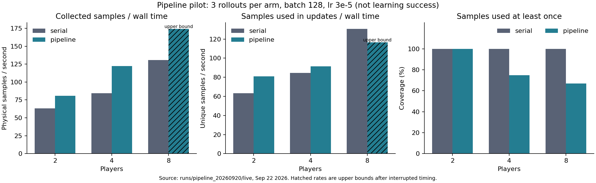

# 采集／训练流水线实测

实机重测开始：2026-09-22T09:25:41+08:00；完成：2026-09-22T18:12:56+08:00。9 月 20 日中断的旧数据保存在 interrupted_live_20260922，未混入本轮比较；中断原因未确定。

本次是有界策略滞后的 PPO 工程短测，不是长期学习效果对照。使用同一个 C 中期 checkpoint，固定 B1 Transformer、每回合上限 1200 物理步（正常终止可提前结束）、batch 128、lr=3e-5、4 个 CPU 计算线程；每种配置连续运行 3 轮、保留 optimizer 状态。两种模式使用相同随机种子及归档/校验路径。

## KL 早停原因与修正

旧实现先执行 optimizer.step，再根据更新前算出的 KL 判断是否停止。这允许已经越界的策略再执行一次更新。现在在下一次 optimizer.step 前检查；被拒绝批次不计入更新，拒绝时的 KL 仍参与阈值自适应。该检查不是更新回滚，也不能保证第一步更新后 KL 永不越界。

同一归档数据、batch 128、新 optimizer，三种 minibatch 打乱种子：

- lr=0.0001：实际更新次数 [1, 1, 1]；结束后 512 个固定探针样本 KL 范围 0.1156–0.1570。
- lr=3e-05：实际更新次数 [76, 76, 76]；结束后 512 个固定探针样本 KL 范围 0.0150–0.0207。
- lr=1e-05：实际更新次数 [76, 76, 76]；结束后 512 个固定探针样本 KL 范围 0.0069–0.0076。

损失拆分的一步更新：

- joint：更新后探针 KL=0.2144。
- policy：更新后探针 KL=0.2192。
- value_shared：更新后探针 KL=0.03685。
- value_head：更新后探针 KL=2.271e-11。

在该 checkpoint/数据上，策略损失是漂移主要来源；仅价值损失更新共享 backbone 也会改变策略，只训练 critic head 则几乎不改变策略。条件动作标准差约 0.51–0.52，不能把问题简单归因于噪声方差塌缩。重放结果支持降低学习率作为短测条件，不能证明它提高实际成功率。

## 流水线边界

采集器独占游戏/TCP，使用冻结模型；训练器独占 optimizer。每轮 snapshot 写入独立文件，队列只允许 1 个待完成请求，策略版本最多落后 1 次实际更新。每批在采集端做全量行为概率复现，训练端另检查冻结模型并在 512 个样本上估计新旧策略 KL；超过 0.03 就丢弃该批，原 PPO minibatch KL 保护继续生效。

旧行为模型对应的 GAE 与概率保留，未实现 V-trace 等完整 off-policy 价值修正；这是小滞后 PPO 试验，绝非与同步 PPO 数学等价。普通 main_ppo 仍默认严格串行，不会自动启用新流程。

## 端到端结果

时间包括采集、完整行为校验、快照/数据落盘、父进程读取、滞后检查、训练和流水线填充/排空；排除进程/游戏启动、64 步预热、最终保存和终评。下面的‘参与更新样本’按每轮去重，不是独立有效样本量。

- **2 players**：串行 63.2 采集样本/秒、63.2 参与更新样本/秒；流水线分别 80.8、80.8，后者相对串行为 1.28×。
  实际采集/训练重叠 27.0 秒；拒绝 0/3 批；参与更新覆盖率 100.0%；整卡峰值占用 6.64 GiB。
- **4 players**：串行 84.5 采集样本/秒、84.5 参与更新样本/秒；流水线分别 122.2、91.5，后者相对串行为 1.08×。
  实际采集/训练重叠 46.1 秒；拒绝 1/3 批；参与更新覆盖率 74.9%；整卡峰值占用 6.65 GiB。
- **8 players**：串行 130.6 采集样本/秒、130.6 参与更新样本/秒；流水线分别 ≤174.2、≤116.7，后者相对串行为 ≤0.89×。
  实际采集/训练重叠 79.3 秒；拒绝 1/3 批；参与更新覆盖率 67.0%；整卡峰值占用 未保存。

**中断恢复说明：**8-player 流水线三轮训练及最终权重均已保存，但终评阶段中断，父进程完整 wall time 和显存峰值未落盘。终评随后从相同权重补齐；吞吐仅按已保存首轮采集开始至末次更新结束的区间推导上界（省略了区间外调度开销），上文用 ≤ 标记，不当作精确测速。

每组每轮的 KL、更新次数、策略版本及时间戳见 live/nXX_mode/results.json。若流水线有丢弃数据，不能只看采集速度选择配置。各 player 数的物理样本预算不同，因此仅比较吞吐；不能按这几轮训练宣布某个 player 数学习更好。

## 验证与后续

六个配置全部完成；全量冻结行为复现最大 ratio 误差 6.1e-05；pipeline_manifest 中源代码/初始权重在测试期间未变化。终评每组只有 2, 2, 4, 4, 8, 8 个同轮复制体，仅用来发现崩溃或明显退化，不是多 seed 成功率验收。

原‘2 players + batch 256’推荐来自旧学习率、旧 KL 检查位置、串行测试及不同 CPU 线程数，不能直接用于本轮。此次降低学习率与修正检查位置在两种模式中一致；串行/流水线对照才可用于估计并行收益。正式扩训仍需共同样本预算、独立训练 seeds 和保留集成功率。

短测驱动、复算脚本和 `live/`、`frozen/` 原始目录已删除。本节数字即该次测量的归档。

## 固定权重的计算对照

每种配置 2 轮；开始 2026-09-22T18:12:56+08:00，完成 2026-09-22T18:30:52+08:00。
真实更新会改变后续轨迹，故追加 lr=0 对照：仍执行四遍完整前向、反向与 optimizer.step，但不改变模型权重；所有其他流水线校验继续保留。此对照用来估计调度/资源重叠收益，不能用于判断学习。

- 2 players：串行 40.3 样本/秒，流水线 84.0 样本/秒（2.09×）；采集／训练重叠 17.3 秒。
- 4 players：串行 82.3 样本/秒，流水线 113.3 样本/秒（1.38×）；采集／训练重叠 29.8 秒。
- 8 players：串行 94.1 样本/秒，流水线 118.3 样本/秒（1.26×）；采集／训练重叠 40.3 秒。

**不能把全部吞吐差异归因于流水线。**固定权重 2-player 首轮尚未与训练重叠，串行组采集已耗时 39.9 秒、流水线组 20.1 秒；存在明显运行间波动。时间戳证明了计算与采集确有重叠，但上述速率比同时受调度、轨迹与运行状态影响，不是纯粹的并行加速倍数。

串行与流水线都包含相同的进程边界、存档和冻结复现开销。Unity reset 和接触求解存在非逐位确定性，即使策略/seed 相同也不能保证轨迹完全一致；每组仅 2–3 轮，不提供可靠置信区间。

产物核验通过：12 个配置的更新计数与逐批记录一致；六个 lr=0 配置的最终权重逐位不变；全部终评使用对应的最终权重。游戏运行配置已恢复，环境文件及源代码 hash 未变；相关回归测试 42 项通过。核验记录见 [artifact_validation.json](artifact_validation.json)。

## 当前后续候选

这次真实更新网格中，最高的已完整测得参与更新吞吐来自 **8 players / serial / batch 128 / lr=3e-5**，约 130.6 样本/秒。建议把它作为下一轮正式学习验证的基线候选；这不是跨模型、跨 seed 的最优结论。流水线实现保留为可选实验，尚不设为普通训练默认。

本轮六个短测模型的确定性终评共 28 回合，1 秒保持成功 0 次。它们使用不同采集量且每组只有一个训练 seed，不能替代共同样本预算的正式成功率比较。正式 C/D/T 最终结果仍见 [第二轮训练结论](../corridor_credit_20260919/CONCLUSION.md)。本次短测已结束，未启动新的六小时正式训练。
