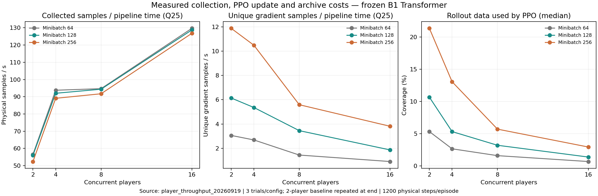

# Player 并行数与训练预算实测

数据来自 2026-09-19T21:05:26+08:00 至 2026-09-19T21:29:53+08:00，同一冻结策略、每回合 1,200 步。机器：NVIDIA GeForce RTX 4070，31.8 GiB RAM。

测试范围内，按实际进入 PPO 梯度更新的不同样本数/秒（重复试验下四分位）选出的候选为 **2 players + minibatch 256**，相对原 2×64 为 **3.88 倍**。该指标是计算与数据使用效率，不能证明学习成功率提升。

显存预留 10% 是本次预算计算的假设，不是用户给定限制；batch 256 的所有实测均完成，峰值约 10.04 GiB。若改为预留 20%，候选变为 2 players + batch 128（约 5.42 GiB）。完整敏感性结果保存在 recommended_plan.json。

单纯采集/更新/存档吞吐最高的组合是 16×64。开始/结束 2-player 基线采集速度变化 -0.2%。

## 全部实测配置

- 2 players / batch 64：采集+更新+存档中位吞吐 57.7 样本/秒；不同梯度样本中位吞吐 3.1/秒（下四分位 3.1）；梯度覆盖率中位数 5.3%；显存峰值保留 2.76 GiB；可行=True。
- 2 players / batch 128：采集+更新+存档中位吞吐 57.7 样本/秒；不同梯度样本中位吞吐 6.2/秒（下四分位 6.1）；梯度覆盖率中位数 10.7%；显存峰值保留 5.42 GiB；可行=True。
- 2 players / batch 256：采集+更新+存档中位吞吐 55.8 样本/秒；不同梯度样本中位吞吐 12.0/秒（下四分位 11.9）；梯度覆盖率中位数 21.3%；显存峰值保留 10.04 GiB；可行=True。
- 4 players / batch 64：采集+更新+存档中位吞吐 100.5 样本/秒；不同梯度样本中位吞吐 2.7/秒（下四分位 2.7）；梯度覆盖率中位数 2.7%；显存峰值保留 2.75 GiB；可行=True。
- 4 players / batch 128：采集+更新+存档中位吞吐 98.5 样本/秒；不同梯度样本中位吞吐 5.5/秒（下四分位 5.4）；梯度覆盖率中位数 5.3%；显存峰值保留 5.42 GiB；可行=True。
- 4 players / batch 256：采集+更新+存档中位吞吐 95.8 样本/秒；不同梯度样本中位吞吐 10.8/秒（下四分位 10.5）；梯度覆盖率中位数 13.1%；显存峰值保留 10.04 GiB；可行=True。
- 8 players / batch 64：采集+更新+存档中位吞吐 100.3 样本/秒；不同梯度样本中位吞吐 1.6/秒（下四分位 1.4）；梯度覆盖率中位数 1.6%；显存峰值保留 2.75 GiB；可行=True。
- 8 players / batch 128：采集+更新+存档中位吞吐 99.1 样本/秒；不同梯度样本中位吞吐 3.7/秒（下四分位 3.5）；梯度覆盖率中位数 3.2%；显存峰值保留 5.42 GiB；可行=True。
- 8 players / batch 256：采集+更新+存档中位吞吐 97.5 样本/秒；不同梯度样本中位吞吐 6.3/秒（下四分位 5.6）；梯度覆盖率中位数 5.7%；显存峰值保留 10.04 GiB；可行=True。
- 16 players / batch 64：采集+更新+存档中位吞吐 132.1 样本/秒；不同梯度样本中位吞吐 0.9/秒（下四分位 0.9）；梯度覆盖率中位数 0.7%；显存峰值保留 2.73 GiB；可行=True。
- 16 players / batch 128：采集+更新+存档中位吞吐 131.5 样本/秒；不同梯度样本中位吞吐 2.0/秒（下四分位 1.9）；梯度覆盖率中位数 1.4%；显存峰值保留 5.42 GiB；可行=True。
- 16 players / batch 256：采集+更新+存档中位吞吐 127.8 样本/秒；不同梯度样本中位吞吐 3.9/秒（下四分位 3.8）；梯度覆盖率中位数 2.9%；显存峰值保留 10.04 GiB；可行=True。

## Python 计算的后续验证方案

预算 6 小时，采用 2 个组合 × 3 seeds，每组共同终点 96,000 物理样本。预计总耗时 5.21 小时，包含 36 分钟余量。

组合：2 players / batch 64、2 players / batch 256。保持奖励、网络和探索配方一致；只有一个参数变化时做单因素对照，两个参数都变化时做组合对照。

后续以 T 时间配方作为候选，使用新的训练 seeds 31、47、61；T 尚未证明跨 seed 稳定改善。吞吐测量来自 C 的冻结模型，T 的 KL 早停和更新成本仍可能不同。

critic 预热保留 2 players × 2 轮，随后按候选并行数续训；回合仍为 1,200 步，不能通过缩短时间范围假装保持相同训练条件。固定样本预算含预热，按真实采集量补轮。

每训练 seed 的训练前评估每模式 4 回合、终点评估每模式 10 回合，评估固定 2 players，并以持续 1 秒成功与成功后跌落验收。C/D/T 实验已按原配置完成；本文件没有启动新的学习对照。

## 方法与边界

完整输入先做冻结策略审计。真实 PPO 更新后丢弃权重；64/128/256 使用同一批归档数据和同一行为模型，保留原学习率及 KL 早停。另有 lr=0 的完整单遍测试，单独比较相同计算量下的 minibatch 效率。

PPO 第一遍 minibatch 不重复；从更新数和实际 batch 大小计算不同样本进入梯度更新的数量，完整多遍则封顶为该 rollout 的样本数。该数量不等于独立有效样本量。较大的 rollout 若很早触发 KL 早停，可能使大量采集数据未参与梯度更新。

并行数推荐只覆盖本次测试网格和冻结模型。不能从吞吐或短更新推导全局最优超参数；实际训练需要用保留集成功率确认。预算使用试验下四分位吞吐及历史评估/critic 预热每样本耗时上四分位；这些是保守规划值，不是置信界。

原始逐次数据见 joint_trials.csv，汇总见 configuration_summary.csv，预算候选见 budget_candidates.csv，机器可读方案见 recommended_plan.json。
